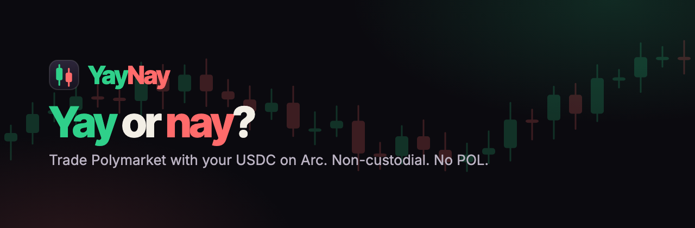
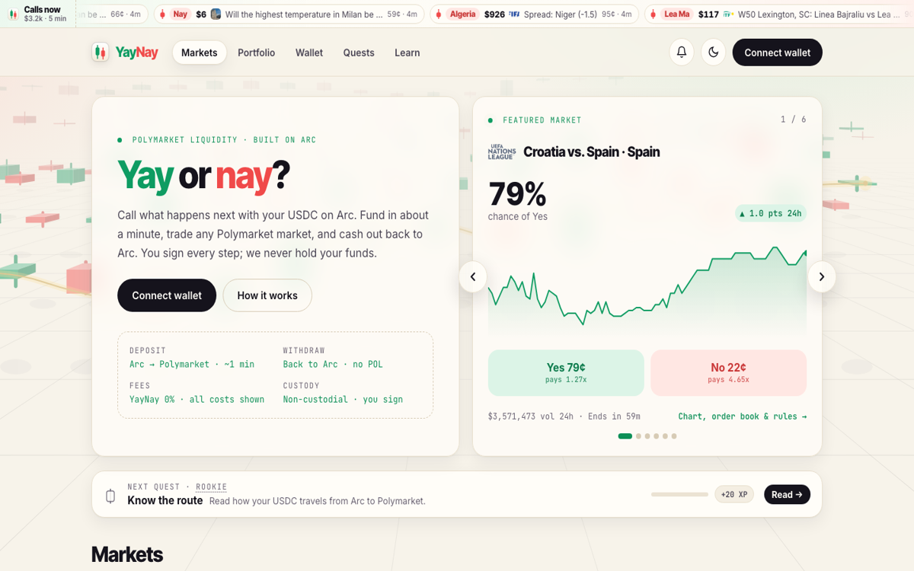
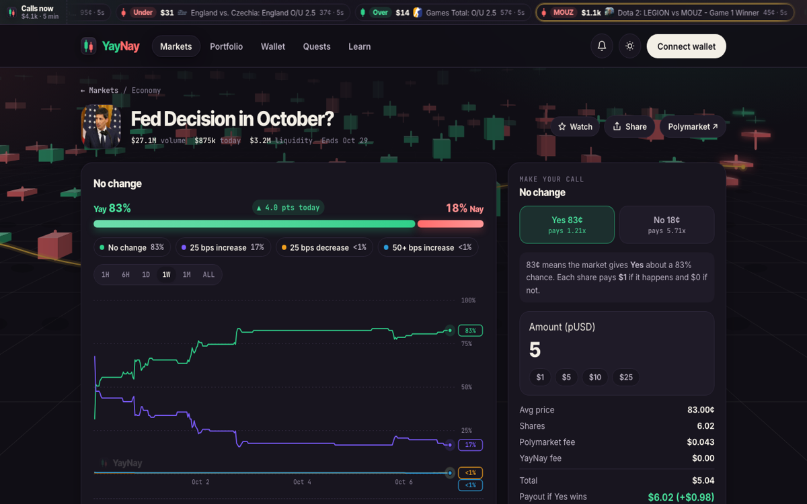
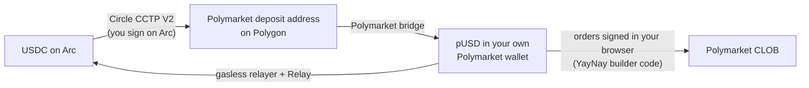

<p align="center">
  
</p>

<p align="center">
  <a href="https://yaynaygo.xyz"><b>Live app</b></a> ·
  <a href="https://yaynaygo.xyz/#/docs/how-it-works">How it works</a> ·
  <a href="https://yaynaygo.xyz/#/docs/security">Security</a> ·
  <a href="https://x.com/yaynay_app">@yaynay_app</a> ·
  <a href="mailto:yaynay.go@gmail.com">Contact</a>
</p>

<p align="center">
  <a href="https://yaynaygo.xyz"></a>
  
  
  
  <a href="LICENSE"></a>
</p>

# YayNay

**Trade Polymarket with your USDC on Arc.** Fund in about a minute, call any market, and cash out back to Arc. No POL, no custody: you sign every step.

Arc, Circle's L1, has native USDC but no prediction market. Polymarket is the largest prediction market, but its deposit bridge doesn't accept Arc, so Arc users had no direct way in. YayNay is that missing road, in both directions.

<p align="center">
  
  
</p>

## ✨ Features

| | |
|---|---|
| 🌉 **Arc → Polymarket in ~1 min** | USDC leaves Arc through Circle CCTP V2 and lands as pUSD in your own Polymarket wallet. |
| ↩️ **Back to Arc, no POL** | Withdraw straight to USDC on Arc. Polymarket's relayer pays the Polygon gas. |
| 📈 **Live market pages** | Order book, prices and trades stream over WebSocket. Line or candle charts, rules and a resolution timeline. Sell from the page. |
| 🧠 **Smart money** | See which side Polymarket's top traders by profit hold, weighted by position size. |
| 🔔 **Price alerts** | "Tell me when Yes hits 70¢", with optional push notifications even when the tab is closed. |
| 🪙 **Top up from any chain** | ETH, USDT, DAI, BTC wrappers and Tempo stablecoins from 7 chains to USDC on Arc via LI.FI, plus EURC → USDC on Arc. |
| 📒 **Portfolio & call history** | Live P&L on open calls, realized P&L and win rate on closed ones. |
| 🕯️ **Quests** | Optional tasks that teach the product. Just for fun: XP has no monetary value. |

## 🔁 How it works



- **Deposit.** You sign an approve and a burn on Arc (CCTP domain 26) with [Circle App Kit](https://docs.arc.io/app-kit.md). Circle's Forwarding Service mints on Polygon straight into your Polymarket deposit address, so you need no POL.
- **Trade.** Orders are signed in your browser with `@polymarket/client` and carry the YayNay builder code. That attributes the volume to us and doesn't change your price.
- **Withdraw.** pUSD goes gaslessly to Polymarket's bridge, then through Relay to native USDC at your Arc address.

### What YayNay uses Arc for

- **Source of funds and home balance.** Your USDC lives on Arc (chain 5042). The app reads it through Arc's USDC ERC-20 interface (`0x3600…0000`) and shows it live.
- **Every deposit leaves from Arc and every withdrawal lands back on Arc**, linked to explorer.arc.io.
- **Arc as the hub.** Funds from other chains come to USDC on Arc first, then into Polymarket.

## 🔒 Security model

- **Non-custodial.** You sign every transaction in your own wallet. YayNay never holds keys or funds, and charges no fee.
- **A small server.** The only server code is a few Cloudflare Pages Functions:
  - `POST /api/session` checks a Turnstile token and sets a 12-hour HttpOnly cookie.
  - `POST /api/builder/sign` adds Polymarket's builder HMAC to an allowlist of requests your browser makes. It requires our own origin and that cookie, and writes are capped per day in D1.
  - IPs are stored only as salted hashes and purged after 3 days.
- **Checked top-ups.** Every LI.FI quote is verified before you sign, including the decoded calldata:
  - the recipient is your own address,
  - the destination is USDC on Arc,
  - the LI.FI contract address is pinned,
  - approvals are for the exact amount,
  - the quote has a minimum output.
- **Compliance gate.** Polymarket's geoblock check runs from your browser. Blocked regions can only browse; close-only regions can sell, claim and withdraw.
- **Not audited yet.** See the in-app pages [Security & what you sign](https://yaynaygo.xyz/#/docs/security) and [Contracts & addresses](https://yaynaygo.xyz/#/docs/contracts).

## ⛓️ Proof on mainnet

| Step | Transaction |
|---|---|
| CCTP burn on Arc (2.5 USDC, signed via App Kit) | [0xd2e45c72…ac20](https://explorer.arc.io/tx/0xd2e45c7241b756c32689b2eff6799522fe9169ace76620705336076842d2ac20) |
| CCTP mint on Polygon into the Polymarket deposit address | [0xbfca6bee…e371](https://polygonscan.com/tx/0xbfca6bee80745bfbe5d5fcaf088f9709ce2d5ec9281abeee1c8b2d212091e371) |
| First order with the YayNay builder code | [0x2820bc23…bf3f](https://polygonscan.com/tx/0x2820bc2392acd733da6d8f836d855e462754ef4f23eb839f5a1bf16685bb5f3f) |
| Withdrawal: pUSD to the Polymarket bridge (gasless) | [0xf15b8564…bc31](https://polygonscan.com/tx/0xf15b856433f7160dd56af2683a39e0b0f30b368cce58d6a33e6637dae93abc31) |
| Withdrawal: USDC delivered on Arc (total cost $0.032, no POL) | [0xba7699f1…5d32](https://explorer.arc.io/tx/0xba7699f16de8207733a38a361227100861aafbe062d0eaf0693192d9f7775d32) |
| Top-up from Tempo arriving on Arc (LI.FI / Across) | [0x92392906…8524](https://explorer.arc.io/tx/0x92392906b01c94db76f18711bec740795d72c3de033ed49812736ab8a4f18524) |

## 🧱 Stack

Vite · React 19 · TypeScript · wagmi/viem · Circle App Kit (CCTP V2) · `@polymarket/client` · Polymarket CLOB WebSocket · Relay · LI.FI REST API · Cloudflare Pages Functions + D1 + Turnstile · Web Push (VAPID, aes128gcm) with a cron Worker · a canvas 3D backdrop and SVG charts with no chart library · vitest (200+ tests).

```
web/
├─ src/           React app (components, lib, styles, docs pages)
├─ server/        shared server code: builder HMAC signer, session, limits, push, proxies
├─ functions/     Cloudflare Pages Functions (/api/*)
├─ push-worker/   cron Worker that sends price-alert pushes
└─ public/        static assets, service worker, security headers
```

## 🛠️ Run locally

```bash
cd web
cp .env.example .env    # fill in VITE_BUILDER_CODE and the builder API credentials
npm install
npm run dev             # http://localhost:5173
```

The builder API credentials come from polymarket.com → Settings → Builder. Only the server-side signer reads them; they never reach the browser. In local dev the Vite server stands in for the Pages Functions, with the same request validation but no Turnstile or D1.

```bash
npm test                # vitest
npx tsc -b              # typecheck
```

<details>
<summary><b>Deploy to Cloudflare Pages</b> (environment variables, push Worker, switching features off)</summary>

```bash
cd web && npm run build
npx wrangler pages deploy dist --project-name <your-project>
```

| Variable | Where | Purpose |
|---|---|---|
| `VITE_BUILDER_CODE` | build | bytes32 builder code (production builds fail without it) |
| `VITE_TURNSTILE_SITE_KEY` | build | Turnstile site key (production builds fail without it) |
| `VITE_GITHUB_URL`, `VITE_X_URL`, `VITE_CONTACT` | build, optional | override the footer/docs links |
| `POLYMARKET_BUILDER_API_KEY`, `POLYMARKET_BUILDER_SECRET`, `POLYMARKET_BUILDER_PASSPHRASE` | secret | builder HMAC |
| `SESSION_SECRET` | secret | signs the session cookie and salts IP hashes (32+ random chars) |
| `TURNSTILE_SECRET_KEY` | secret | Turnstile verification |
| `ALLOWED_ORIGINS` | var, optional | extra origins besides the deployment's own |
| `DB` | D1 binding | daily limits and push alerts (`wrangler d1 create yaynay-limits`; tables are created on first use, or apply `schema.sql`) |
| `VAPID_PUBLIC_KEY` | var, optional | enables "alerts when YayNay is closed" (`node scripts/vapid.mjs` prints a key pair) |
| `LIFI_API_KEY` | secret, optional | fallback for top-up quotes once a network uses LI.FI's anonymous quota (75 quotes / 2 h per IP). Never sent to the browser. Caps: `LIFI_PER_IP_DAILY` = 300, `LIFI_GLOBAL_DAILY` = 20000 |
| `NANSEN_API_KEY`, `NANSEN_ENABLED=1` | secret + var, optional | Nansen trader stats behind `/api/nansen/*`. Needs a signer session. Caps: `NANSEN_PER_IP_DAILY` = 60, `NANSEN_GLOBAL_DAILY` = 2000. Pair with the build var `VITE_NANSEN=1` |

**Push alert checker (optional).** Pages Functions can't run cron, so a small Worker in `web/push-worker/` checks alerts every minute.
- Limits per IP: 2 new subscriptions and 100 new alerts a day.
- Alerts on unknown tokens are rejected, and armed alerts expire after 60 days.
- On the D1 free tier, keep armed alerts under about 3,000, because each run reads every armed token.

```bash
cd web
# fill in database_id and VAPID_SUBJECT in push-worker/wrangler.toml
npx wrangler secret put VAPID_PUBLIC_KEY -c push-worker/wrangler.toml
npx wrangler secret put VAPID_PRIVATE_KEY -c push-worker/wrangler.toml
npx wrangler deploy -c push-worker/wrangler.toml
```

**Switching optional features off.** Pages variables apply to new deployments, so redeploy after changing them.
- **Push:** remove `VAPID_PUBLIC_KEY` and redeploy. Each browser then deletes its own server rows and unregisters the service worker the next time it opens the app. Stop the checker with `npx wrangler delete -c push-worker/wrangler.toml`.
- **Nansen:** set `NANSEN_ENABLED` to anything but `1` and redeploy. The smart-money card falls back to Polymarket's free data. Then revoke the key.

</details>

## 💬 Support & contact

- **Help:** [yaynaygo.xyz → Help & contact](https://yaynaygo.xyz/#/docs/support) and [Where are my funds?](https://yaynaygo.xyz/#/docs/troubleshooting)
- **Email:** [yaynay.go@gmail.com](mailto:yaynay.go@gmail.com)
- **X:** [@yaynay_app](https://x.com/yaynay_app)
- **Bugs & ideas:** [open an issue](https://github.com/Yaynaygo/yaynay/issues)
- **Security issues:** please email first and don't open a public issue.

We will never ask for your seed phrase or private key.

## ⚖️ Disclaimer

YayNay is an independent interface. It is not affiliated with, endorsed by, or operated by Polymarket or Circle. Markets are operated by Polymarket, and its [Terms](https://polymarket.com/tos) apply. Prediction markets are not available in every region, and the app checks yours. Nothing here is financial advice; you can lose the full amount of any position.

Arc™ is a trademark of Circle Internet Group, Inc. and/or its affiliates.

Released under the [MIT License](LICENSE).
